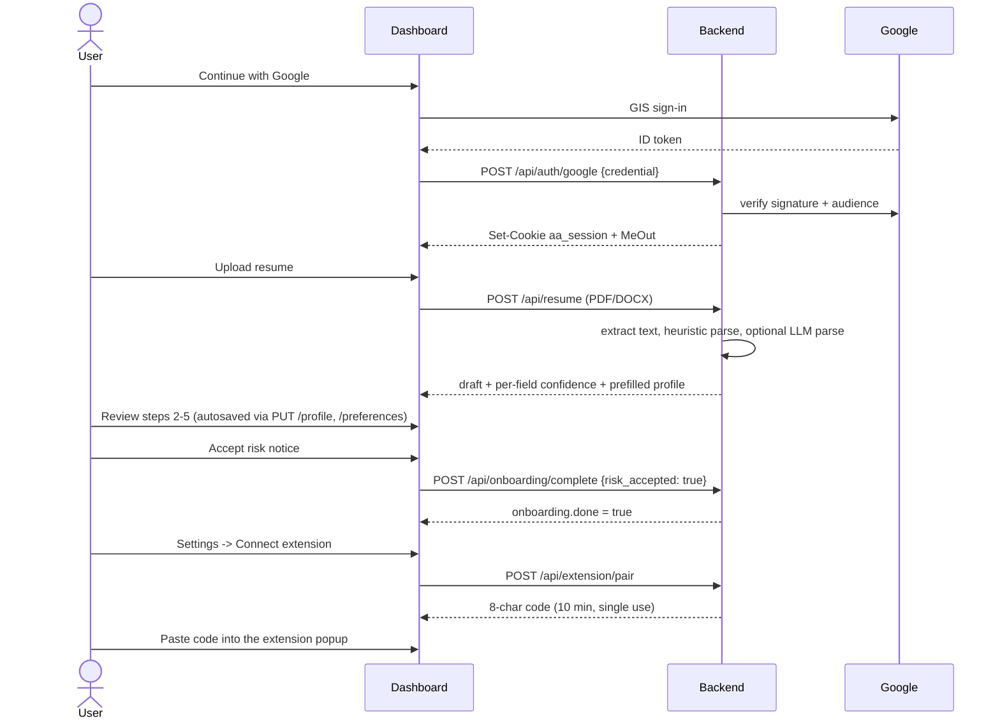
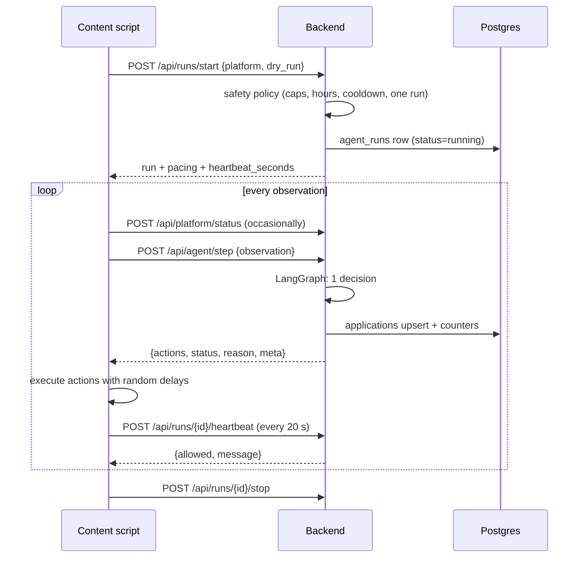
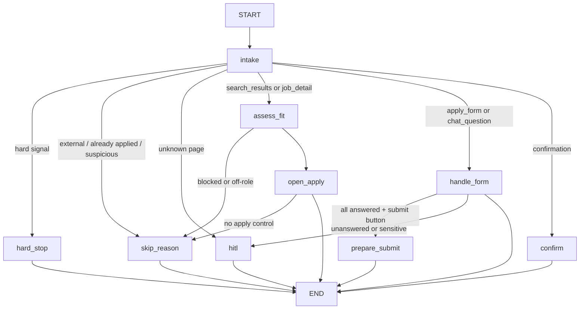
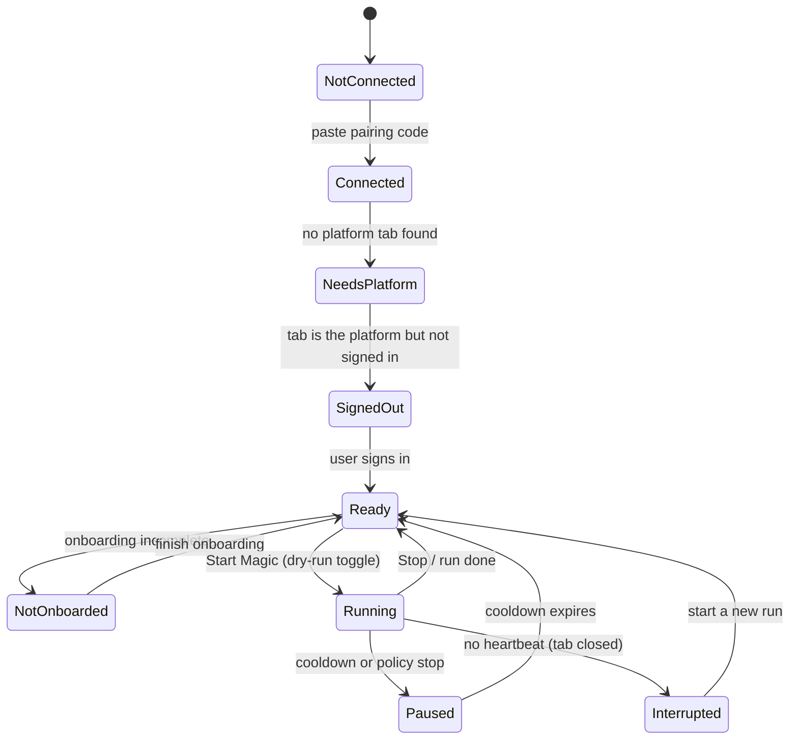
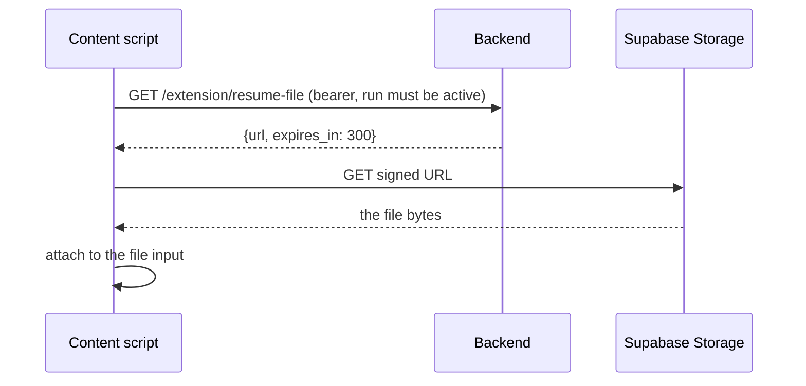

# AutoApply — Backend Architecture, Flow and Extension Contract

How the backend actually works, what every endpoint does, and exactly what the
extension must send and will receive. Written from the code, not from the plan, so
where the two disagree this file is right.

- Backend code: `backend/app/`
- Wire contract (frozen): `packages/shared/contract.schema.json`
- Status / build order: `V1-BUILD-PLAN.md`
- Setup and run: `backend/README.md`

---

## 1. The one idea that explains everything

**The extension owns the page. The backend owns the decisions.**

The backend never sees a DOM node, a CSS selector or a URL it could navigate to. It
receives a description of the current page (`Observation`), decides what to do, and
returns a small batch of allow-listed actions (`AgentResponse`). The extension
executes them in the user's real, signed-in browser.

That split exists for two reasons:

1. **Security.** Job descriptions and recruiter messages are attacker-controlled text
   that reaches an LLM. If the model could emit selectors or URLs, a hostile job post
   could steer it. With ref-handles and eight action types, the worst it can do is
   fill the wrong field on the page you are already on.
2. **Reliability.** Chrome throttles background tabs and sleeps service workers.
   Anything that "stays alive" server-side is a lie. The loop has to live in the tab
   that is actually rendering the page.

```mermaid
flowchart LR
  subgraph Browser["User's Chrome (signed in to LinkedIn / Naukri)"]
    CS["Content script<br/>reads DOM, acts, paces"] -->|"Observation"| SW["Service worker<br/>network only"]
    SW -->|"HTTP"| API
    API -->|"AgentResponse"| SW
    SW -->|"actions"| CS
  end
  subgraph Server["FastAPI"]
    API["POST /agent/step"] --> G["LangGraph<br/>(stateless)"]
    G --> ANS["Answer engine<br/>rules → bank → LLM → human"]
    G --> POL["Safety policy"]
  end
  DB[("Postgres / Neon")] --- API
  DASH["Dashboard (React)"] -->|"cookie session, polling"| API
  FILES[("Supabase Storage<br/>private, signed URLs)"] --- API
```

---

## 2. Two credentials, two scopes, no overlap

| | Dashboard | Extension |
|---|---|---|
| Credential | `aa_session` cookie (opaque, hashed in `sessions`) | `Authorization: Bearer aa_ext_...` (hashed in `extension_tokens`) |
| Created by | `POST /api/auth/google` | `POST /api/extension/pair` → `POST /api/extension/connect` |
| Lifetime | 30 days, rolling `last_seen_at` | until revoked in Settings |
| Can | all of the user's own data | post observations, drive runs, upload screenshots, fetch the resume **during an active run** |
| Cannot | — | read `/profile`, `/preferences`, `/qa`, `/applications`, or mint tokens |
| Extra gate | `X-Requested-With: XMLHttpRequest` on every non-GET | — |

There are no passwords anywhere in the schema. Sign-in is Google only: the dashboard
gets an ID token from Google Identity Services and posts it to `/auth/google`, where
it is verified against Google's keys and the expected audience.

Every query is scoped by the `user_id` on that credential. No endpoint accepts a user
id from the request body.

---

## 3. Total flow, end to end

### 3.1 Setup (dashboard, once)



### 3.2 Run (extension + backend)



The dashboard learns about all of this by **polling** `GET /api/runs/active` and
`GET /api/applications?since=...` every 3–5 s while a run is active. There is no
websocket, no SSE and no message queue (see §7).

---

## 4. The wire contract (extension ⇄ backend)

Frozen in `packages/shared/contract.schema.json`. Pydantic mirror in
`backend/app/contract/models.py`; a test asserts both agree on valid **and** invalid
payloads.

### 4.1 Observation (extension → backend)

```json
{
  "run_id": "9f1c...-uuid",
  "platform": "linkedin",
  "page_type": "apply_form",
  "job": {
    "id": "4012345",
    "title": "Backend Engineer",
    "company": "Acme Systems",
    "location": "Pune, IN",
    "job_url": "https://www.linkedin.com/jobs/view/4012345",
    "already_applied": false,
    "external": false
  },
  "elements": [
    { "ref": "f1", "kind": "text",     "label": "Mobile number", "required": true, "value": "" },
    { "ref": "f2", "kind": "select",   "label": "Notice period", "options": ["30 days", "60 days"], "required": true },
    { "ref": "f3", "kind": "file",     "label": "Resume",        "required": false },
    { "ref": "b1", "kind": "button",   "label": "Next" }
  ],
  "chat": { "question": "What is your expected CTC?", "input_ref": "c1" },
  "page_text_digest": "optional short excerpt, max 4000 chars",
  "signals": []
}
```

| Field | Rules |
|---|---|
| `run_id` | must be the run this token owns, otherwise `409`/`404` |
| `platform` | `linkedin` \| `naukri`; must match the run |
| `page_type` | `search_results` \| `job_detail` \| `apply_form` \| `chat_question` \| `confirmation` \| `external` \| `unknown` |
| `job.id` | required, ≤120 chars. The ledger's identity for the job |
| `elements[].ref` | `^[a-z][0-9]{1,4}$` (e.g. `f12`, `c1`, `b3`). **Only valid for this observation** |
| `elements[].kind` | `text` \| `select` \| `radio` \| `checkbox` \| `file` \| `button` |
| `elements[].options` | the form's own choices, ≤100 |
| `page_text_digest` | used for injection scanning and nothing else |
| `signals` | `captcha`, `checkpoint`, `warning_banner`, `forced_logout`, `rate_limited`, `unknown_page`, `suspicious_content` |

Limits: ≤200 elements, ≤10 signals, every string bounded. Unknown keys are rejected
(`additionalProperties: false`).

### 4.2 Response (backend → extension)

```json
{
  "actions": [
    { "type": "fill_text", "ref": "f1", "value": "+91 98765 43210" },
    { "type": "select_option", "ref": "f2", "value": "60 days" },
    { "type": "attach_resume", "ref": "f3" },
    { "type": "click", "ref": "b1" }
  ],
  "status": "continue",
  "reason": null,
  "meta": {
    "run_id": "9f1c...",
    "run_status": "running",
    "job_status": null,
    "applied_count": 3,
    "skipped_count": 5,
    "stuck_count": 1,
    "llm_calls": 4,
    "llm_calls_left": 26,
    "trace_id": "6a2b...",
    "pacing": { "action_delay_ms": 940, "apply_pause_s": 112, "long_break_s": null }
  }
}
```

| Action | Requires | Meaning |
|---|---|---|
| `fill_text` | `ref` + `value` | type into a text field |
| `select_option` | `ref` + `value` | pick an option by its visible label |
| `check` | `ref` | tick a checkbox |
| `attach_resume` | `ref` | attach the file from `GET /extension/resume-file` |
| `click` | `ref` | click that element |
| `wait` | `ms` (100–30000) | pause |
| `submit` | — | submit the application |
| `finish` | — | stop working this page |

`status` is `continue` (do the actions, observe again), `done` (job finished, move to
the next one), `hitl` (a human is needed) or `stop` (halt the whole run).

`reason` is required for `hitl` and `stop`, ≤60 chars, and is one of the values in
`app/db/enums.py` (`ApplicationReason`), rendered for humans by
`services/applications.py:REASON_LABELS`. `meta` is presentation-only: **never derive
an action from it.**

Hard rules, enforced in code on both sides:

- ≤10 actions per response; ≤8 action types.
- Actions may only reference a `ref` present in the observation that produced them
  (`app/agents/tools.py:validate_actions`). Anything else is dropped and the step
  becomes `hitl` / `form_error`.
- The extension must refuse a click that would leave the platform's domain.
- `submit` is impossible in dry-run: it is stripped twice, once in the graph node and
  once in `build_response`.

---

## 5. Backend logic

### 5.1 One decision per request

`POST /api/agent/step` runs the whole graph from the start, every time. There is no
suspended execution and no checkpointer (`app/agents/graph.py`). Input = the
observation; output = one decision. Three consequences:

- the backend is stateless and horizontally scalable;
- a dropped request is safe to retry (the ledger upsert is idempotent);
- a reloaded tab resumes by **re-observing**, not by replaying.

### 5.2 Graph nodes



| Node | File | Decision |
|---|---|---|
| `intake` | `nodes/guard.py` | safety signals first, then page-type routing |
| `hard_stop` | `nodes/guard.py` | `status=stop` |
| `skip_reason` | `nodes/guard.py` | `status=done`, job marked `skipped` |
| `hitl` | `nodes/guard.py` | `status=hitl`, job marked `needs_attention` |
| `assess_fit` | `nodes/navigate.py` | blocklist + role match |
| `open_apply` | `nodes/navigate.py` | click the best job card / the Easy Apply button |
| `handle_form` | `nodes/form.py` | answer every field, then `next` / `submit` |
| `prepare_submit` | `nodes/form.py` | the dry-run gate |
| `confirm` | `nodes/outcome.py` | mark `applied` |

### 5.3 How a form gets filled

Per field, in this order — the whole cost model lives here:

1. **Profile rules** (no model call). Name, email, phone, location, links, notice
   period, current and expected CTC, total years, current title/company, work
   authorisation, relocation, highest qualification, "<n> years in <skill>".
2. **`qa_bank`** — a previously saved, approved answer for the same normalised question.
3. **LLM classifier** (`Groq`) — is this `standard`, `sensitive` or `unknown`?
4. **LLM answer** — only for `standard`, only while the run has budget left, and only
   if the answer passes a groundedness check (no number or contact detail that is not
   already in the profile). A passing answer is saved to `qa_bank` as **unapproved**,
   so it is reused only after a human accepts it.
5. **HITL** — everything else.

If any field cannot be answered, the whole step becomes `hitl` and **no actions are
returned**: a half-filled application completed by hand is safer than a
half-automated one.

Two small deterministic wins:

- Profile values are fitted to the form's own options (`18 LPA` → `18`,
  `2 months` → `60 days`) so selects work.
- Standard consent checkboxes ("I agree to the terms…") are ticked automatically;
  anything that also looks legal or sensitive is not.

### 5.4 Sensitive questions: never answered, always escalated

Matched by regex before any model call: gender, marital status, date of birth/age,
disability or health, caste/religion, pregnancy, criminal record, visa/legal
declarations, nationality, background checks, and salary negotiation.

**Not** sensitive, and therefore answered from the profile: current CTC, expected
CTC, notice period, joining availability, total and skill-specific experience,
current location, willingness to relocate. These are the ordinary Naukri chat
questions; blocking them would make the product useless.

Verified by `python -m evals.run sensitive` — 100% sensitive recall, 100% specificity
on the standard set.

### 5.5 Safety policy (deterministic; the LLM cannot override it)

Checked at `/runs/start`, on every heartbeat, on **every submission** (§5.5.1), and
again locally in the extension.

| Rule | Default | Hard ceiling in code |
|---|---|---|
| **Daily quota** | `min(user, 10)` per quota day | 25 |
| **Quota reset** | 10:00 local time (`SAFETY_DAY_RESET_HOUR`) | — |
| Hourly cap | 3 | 6 |
| Warm-up | 14 days, ramping 5/day → 10/day | — |
| Rest day | one per week (`SAFETY_REST_DAY`) | — |
| Action delay | 400–1800 ms (+ occasional hesitation) | floor 250 ms |
| Pause between applications | 45–180 s | floor 30 s |
| Long break | every 8 applications, 4–10 min | — |
| Active hours | user's window, default 09:00–21:00 in their timezone | never overnight |
| Run window | 120 min | — |
| Concurrency | one run, one tab, one platform | DB partial unique index |
| Model budget | 30 calls per run **and** 60 per quota day | — |
| **Hard stop** | CAPTCHA, checkpoint, warning banner, forced logout, rate limit, unrecognised page | ends the run |

Cooldowns after a hard stop: CAPTCHA and security checkpoint **48 h**; warning banner,
forced logout, rate limit **24 h**.

#### 5.5.1 The daily quota in detail

Three numbers decide how many applications happen in a day:

```
effective_daily_cap = min( user.daily_cap,  SAFETY_DAILY_CAP,  25,  warmup_cap )
                      └ user setting   └ env default (10)     └ code ceiling
```

`warmup_cap` ramps a new account from `SAFETY_WARMUP_START_CAP` (5) to the full
allowance over `SAFETY_WARMUP_DAYS` (14). So **10/day is the steady state, not day
one** — a brand-new LinkedIn account that applies to 10 jobs on its first morning is
exactly the pattern that gets restricted.

```text
day  0:  5/day
day  7:  7/day
day 14: 10/day   (and stays there)
```

**When it resets.** Not at midnight. The quota window runs from 10:00 to 10:00 in the
user's own timezone (`SAFETY_DAY_RESET_HOUR`, default 10; timezone from
`preferences.active_hours.timezone`, default `Asia/Kolkata`). Applications made at
09:00 count against the previous window, applications made at 11:00 start the new one.
Every response that carries `usage` includes `quota_resets_at` so the UI can say
"resets in 13 h" instead of guessing.

**What counts.** `applied` **and** `dry_run`. A practice run never submits, but it
still hammers the platform, so it still spends the allowance.

**Who enforces it.** Three independent places, because one is not enough:

| Point | What it stops |
|---|---|
| `/runs/start` | starting a run with no allowance left (403 `policy_blocked`) |
| `/runs/{id}/heartbeat` | a run that outlived its allowance (`allowed: false`) |
| **`/agent/step`, at the submit itself** | the actual submission (`check_submit_allowed`) |

The third one is the important one. The extension is not trusted to stop on its own,
and a run can outlive its allowance, so every submission is re-checked server-side. If
the allowance is gone, the `submit` action is **removed from the response before it is
sent**, the job is logged as `skipped` / `cap_reached`, and the run ends — rather than
filling forms that can never be submitted.

**Model spend is bounded twice.** `LLM_MAX_CALLS_PER_RUN` (30) caps one run;
`LLM_MAX_CALLS_PER_DAY` (60) caps the whole quota day across every run, so starting ten
short runs cannot multiply the bill. When the budget is gone, unknown questions go
straight to HITL instead of to a model.

### 5.6 HITL vs hard stop — different mechanisms

| | HITL | Hard stop |
|---|---|---|
| Trigger | sensitive/unknown question, low confidence, unrecognised page | `signals` include a risk signal |
| Node | `hitl` | `hard_stop` |
| Response | `status: "hitl"` | `status: "stop"` |
| Run | **stays `running`**; the agent moves to the next job | `status=stopped` immediately |
| Ledger | `needs_attention` + reason, `stuck_count += 1` | `needs_attention`, plus a `safety_events` row |
| Blocking | nothing | `/runs/start` → **403** `policy_blocked` until the cooldown passes |
| Cleared by | `PATCH /api/applications/{id}` → `resolved` | time, or manual intervention in the platform |

A cooldown is a row, not a timer: `safety_events.cooldown_until`, re-read by
`active_cooldown()` on start and on every heartbeat.

### 5.7 Counters and idempotency

`applications` has `UNIQUE (user_id, platform, job_id)`. Recording is an upsert, and
run counters only move when the row's status actually changed — so a retried step or a
duplicate confirmation never inflates the numbers. `applied` is written **before** the
submit click, so a tab that dies right after submitting still leaves an honest ledger
entry, and the next run sees `already_applied`.

### 5.8 Background maintenance

One asyncio task inside the API process (`app/safety/sweeper.py`):

- every 60 s — runs with a heartbeat older than 180 s become `interrupted`
- every 60 min — expire sessions, drop used pairing codes, delete screenshots older
  than 14 days

`POST /internal/sweep` does the same on demand behind `X-Cron-Secret`, for when you
scale past one instance.

### 5.9 No queue, and why

There is no Celery, no Redis, no SQS. The work cannot be queued server-side because
the action must execute inside the user's signed-in browser. The extension is the
consumer; the platform's job list is the queue.

Ordering, retry and liveness are covered by:

- the content script driving one step at a time (nothing runs concurrently),
- the heartbeat + `interrupt_if_stale` check at the top of `/agent/step`,
- the sweeper for abandoned runs.

---

## 6. API reference

Base path `/api`. Interactive docs at `/docs` in development only. There are 33
routes; the extension uses 8 of them.

### 6.0 Conventions

**Dashboard requests** (cookie):

```http
Cookie: aa_session=...
X-Requested-With: XMLHttpRequest        # required on POST/PUT/PATCH/DELETE
```

**Extension requests** (bearer):

```http
Authorization: Bearer aa_ext_...
```

**Errors** — every failure returns the same envelope:

```json
{ "error": { "code": "policy_blocked", "message": "Paused for safety until 28 Oct, 16:02.", "details": {...} } }
```

`message` is written for a person and is safe to display. `details` is optional and
carries field-level information for forms.

| Code | HTTP | When |
|---|---|---|
| `auth_required` | 401 | no/expired/revoked credential |
| `invalid_credentials` | 401 | bad Google token or pairing code |
| `forbidden` | 403 | missing CSRF header, wrong scope |
| `policy_blocked` | 403 | safety rules refused the start |
| `not_found` | 404 | not yours, or gone |
| `conflict` | 409 | a run is already active, or the run is not running |
| `payload_too_large` | 413 | upload over the limit |
| `unsupported_media` | 415 | wrong file type |
| `unprocessable` / `validation_error` | 422 | bad fields |
| `rate_limited` | 429 | includes `Retry-After` |
| `upstream_unavailable` | 502 | provider failure |

**Rate limits** (per IP, in-process): `auth` 20/min · `dev-auth` 30/min · `pair`
10/min · `extension-connect` 10/5 min · `resume` 6/min · `agent-step` 180/min ·
`screenshot` 30/min.

---

### 6.1 Dashboard API

#### Auth

| Method | Path | Body | Returns |
|---|---|---|---|
| POST | `/auth/google` | `{credential}` | `MeOut`, sets `aa_session` |
| POST | `/auth/dev-login` | `{email?}` | `MeOut` — **404 outside development** |
| POST | `/auth/logout` | — | `204`, clears the cookie |
| GET | `/auth/me` | — | `MeOut` |

`MeOut`:

```json
{
  "user": { "id": "uuid", "email": "...", "name": "...", "avatar_url": "...", "created_at": "..." },
  "onboarding": { "step": 3, "done": false, "has_resume": true, "parse_status": "parsed", "needs_risk_consent": true },
  "platforms": [ { "platform": "linkedin", "signed_in": true, "last_seen_at": "..." },
                 { "platform": "naukri", "signed_in": false, "last_seen_at": null } ],
  "preferences_ready": true,
  "llm": { "enabled": true, "resume_parse": ["nvidia","groq"], "classify": ["groq-small"], "answer": ["nvidia"], "max_calls_per_run": 30 }
}
```

#### Onboarding

| Method | Path | Body | Returns |
|---|---|---|---|
| POST | `/resume` | multipart `file` (PDF/DOCX ≤5 MB) | `ResumeOut` |
| GET | `/resume/draft` | — | `ResumeOut` (404 before any upload) |
| GET | `/resume/file-url` | — | `{url, expires_in}` (signed, 300 s) |
| POST | `/resume/manual` | — | `ResumeOut`, `parse_status: "manual"` |
| GET | `/profile` | — | `ProfileOut` |
| PUT | `/profile` | partial `ProfileUpdate` | `ProfileOut` |
| GET | `/preferences` | — | `PreferenceOut` |
| PUT | `/preferences` | partial `PreferenceUpdate` | `PreferenceOut` |
| POST | `/onboarding/complete` | `{risk_accepted: true}` | `MeOut` (422 unless name, roles and platforms are set) |

`ResumeOut` on success:

```json
{
  "parse_status": "parsed",
  "message": null,
  "draft": { "full_name": "Priya Sharma", "…": "…", "confidence": {"email": "high", "years_of_experience": "medium"} },
  "confidence": { "email": "high", "phone": "medium", "skills": "high", "years_of_experience": "medium" },
  "profile": { "…ProfileOut…" }
}
```

On a scanned PDF the endpoint **succeeds** with `parse_status: "failed"` and
`message: "We couldn't read this file. …"` so the UI can show the manual fallback
rather than an error toast. Only a wrong type (`415`) or oversize file (`413`) is an
HTTP error.

#### Answers

| Method | Path | Body | Returns |
|---|---|---|---|
| GET | `/qa` | — | `[QaOut]` |
| POST | `/qa` | `{question, answer, sensitive?}` | `201 QaOut` (409 on duplicate) |
| PATCH | `/qa/{id}` | `{answer?, approved?, sensitive?}` | `QaOut` |
| DELETE | `/qa/{id}` | — | `204` |

#### Extension management

| Method | Path | Body | Returns |
|---|---|---|---|
| POST | `/extension/pair` | — | `{code, expires_at, instructions}` — 10 min, single use |
| GET | `/extension/tokens` | — | `[{id, label, install_id, created_at, last_used_at, revoked_at, active}]` |
| DELETE | `/extension/tokens/{id}` | — | `204` (revoked instantly) |

#### Live view

| Method | Path | Query | Returns |
|---|---|---|---|
| GET | `/runs/active` | — | `{run|null, today, unresolved, heartbeat_seconds}` |
| GET | `/applications` | `since`, `status`, `platform`, `limit` (≤200), `offset` | `{items, total_unresolved}` |
| PATCH | `/applications/{id}` | `{status: "resolved"\|"skipped", reason?}` | `ApplicationOut` |
| GET | `/applications/{id}/screenshot-url` | — | `{url, expires_in}` |
| GET | `/safety/status` | — | `{allowed, message, reason, cooldown_until, usage, daily_ceilings}` |
| DELETE | `/account` | — | `204` — rows **and** storage objects |

`today` is `{applied, dry_run, skipped, needs_attention, resolved, failed}` counted
from local midnight in the user's active-hours timezone.

Polling guidance: poll `/runs/active` every 3 s while `run.status == "running"`, every
15 s otherwise, and stop polling when the tab is hidden.

---

### 6.2 Extension API

All of these take the bearer token except `/extension/connect`.

| Method | Path | Body | Returns |
|---|---|---|---|
| POST | `/extension/connect` | `{code, install_id?, label?}` | `{token, user_email, user_name}` — **once** |
| POST | `/platform/status` | `{platform, signed_in}` | `204` |
| GET | `/extension/resume-file` | — | `{url, expires_in}`; **404 unless a run is active** |
| POST | `/runs/start` | `{platform, dry_run}` | `StartRunOut`; 403 `policy_blocked` or 409 if a run exists |
| POST | `/runs/{id}/heartbeat` | — | `HeartbeatOut` |
| POST | `/runs/{id}/stop` | `{reason?}` | `RunOut` |
| POST | `/agent/step` | `Observation` | `AgentResponse` |
| POST | `/applications/{id}/screenshot` | multipart `file` (PNG/JPEG/WebP ≤2 MB) | `204` |

`StartRunOut`:

```json
{
  "run": {
    "id": "uuid", "platform": "linkedin", "status": "running", "dry_run": true,
    "started_at": "...", "ended_at": null, "last_heartbeat_at": "...",
    "window_end": "...", "max_applications": 5,
    "applied_count": 0, "skipped_count": 0, "stuck_count": 0,
    "llm_calls": 0, "stop_reason": null
  },
  "pacing": { "action_delay_ms": 940, "apply_pause_s": 112, "long_break_s": null },
  "heartbeat_seconds": 20,
  "keep_tab_visible": true,
  "usage": { "applied_today": 0, "applied_last_hour": 0, "effective_daily_cap": 5,
             "effective_hourly_cap": 3, "warmup_cap": 5, "cooldown_until": null,
             "active_hours": "09:00-21:00", "active_timezone": "Asia/Kolkata", "rest_day": 6 }
}
```

`HeartbeatOut` — `{run, allowed, message, reason?, cooldown_until?}`. When `allowed`
is false the extension must stop immediately and show `message`; the backend has
already ended the run.

`max_applications` is the remaining daily allowance capped by
`SAFETY_MAX_RUN_APPLICATIONS`, so a new account's first run is small by design.

### 6.3 Meta endpoints

| Method | Path | Auth | Purpose |
|---|---|---|---|
| GET | `/health` | none | `{status, database, version, env, llm}` |
| POST | `/internal/sweep` | `X-Cron-Secret` | run the maintenance jobs now |
| GET | `/files/{key}` | signed query | local-storage file delivery (dev only) |

---

## 7. Extension behaviour specification

### 7.1 Popup state machine



What each state shows: the reason, one primary button, and — while running — live
counters, Pause and Stop, and the line *"Keep this tab open in its own window. You can
keep working in another window."*

### 7.2 What the content script does

```
on load / on URL change:
  detect platform (linkedin.com/jobs*, naukri.com*)
  detect signed-in state
  POST /platform/status {platform, signed_in}
  if signed_in and onboarding done and no active run: show the in-page "Start Magic" banner

while run active:
  heartbeat every heartbeat_seconds
  loop:
    observation = read the page      (see 7.3)
    response   = POST /agent/step
    if response.status == stop  -> stop everything, show reason
    if response.status == hitl  -> capture screenshot, show "Needs you", next job
    execute actions with delays, clamped to >= 250 ms
    wait pacing.action_delay_ms between actions
    randomise, never in fixed order
```

The loop lives in the **content script of the visible tab**. The MV3 service worker
only does network calls, token storage and `chrome.power` keep-awake while a run is
active. Background tabs are throttled by Chrome, which is why the UI tells the user to
keep the tab visible.

### 7.3 Building an observation

| `page_type` | `elements` to report | `signals` to set |
|---|---|---|
| `search_results` | the top job cards as `kind: "button"`, `label` = card text ("Backend Engineer at Acme") — the backend picks one by label | — |
| `job_detail` | the visible action buttons (`Easy Apply`, `Apply`, `Share`, `Save`) | — |
| `apply_form` | every field with its visible `label`, `kind`, `options`, `required`, current `value`, plus the buttons (`Next`, `Review`, `Submit application`) | — |
| `chat_question` | the chat input as `chat.input_ref` plus the buttons | — |
| `confirmation` | none | — |
| `external` | none | — |
| `unknown` | best effort | `unknown_page` |

Label hygiene matters: the backend matches button labels to decide `next` vs `submit`
and to pick a job card. Report the **visible text**, trimmed, without the keyboard
shortcut or icon.

Signals: `captcha` (visible challenge), `checkpoint` (security verification page),
`warning_banner` (platform warning strip), `forced_logout` (session ended),
`rate_limited` (platform rate-limit page), `unknown_page`, `suspicious_content`
(page text addressed to an AI).

### 7.4 What the extension must enforce locally

Do not trust the server blindly — these floors are the difference between a bad
backend deploy and a banned account:

1. Never act faster than 250 ms between interactions.
2. Never click an element that leaves the platform's domain.
3. Never run two runs, two tabs or two platforms at once.
4. Drop any action whose `ref` is not in the observation you just sent.
5. Stop immediately on `status: "stop"`, on any risk signal, or after 3 consecutive
   errors.
6. Never attach a file other than the one from `/extension/resume-file`.
7. Never store the resume or profile locally beyond the active run.

### 7.5 Attaching the resume



This is the only time the extension token touches the resume, and it only works while
a run is active.

### 7.6 Screenshots for stuck steps

On `hitl`, if the current page has a visible application dialog, capture the visible
tab, crop to the dialog, and `POST /applications/{id}/screenshot`. The application id
comes from `GET /applications` (matched on `job_id`) — or skip the upload; the reason
and link are what the user needs most. Screenshots are deleted after 14 days.

---

## 8. Data model, briefly

```
users                    google_sub, email (no password column exists)
sessions                 opaque token hash, expiry, revocation
profiles                 identity, links, skills, CTC, notice, resume key, onboarding step
preferences              roles, locations, modes, hours, caps, blocklists
qa_bank                  normalised question → answer, approved?, source user|ai
platform_connections     per-platform signed_in + last_seen_at
extension_tokens         token hash, scope, last_used_at, revoked_at
extension_pairing_codes  code hash, expiry, used_at
applications             one row per (user, platform, job) — status + reason + evidence
agent_runs               status, counters, llm_calls, stop_reason, agent_state
safety_events            hard stops and cooldowns
```

Enums are `String` + `CHECK` constraints, not Postgres enums, so adding a value is a
one-line migration.

---

## 9. Failure modes and who handles them

| Situation | Backend does | Extension must do |
|---|---|---|
| Question is sensitive | `hitl` + `needs_attention`, no actions | screenshot, show "Needs you", move on |
| No answer and no LLM budget | `hitl` / `unknown_question` | same |
| CAPTCHA / checkpoint | `stop`, `safety_events`, 24–48 h cooldown | halt, show the cooldown message |
| 3 repeated errors | count is tracked client-side | halt and stop the run |
| Tab closed / laptop sleeps | heartbeat expires → `interrupted` | on reopen, show "Interrupted" + restart |
| Job applies off-platform | `skipped` + `external_redirect` | nothing; link is on the dashboard |
| Already applied | `skipped` + `already_applied` | next job |
| Daily/hourly cap hit | submit stripped at `/agent/step`, run ends, job logged `cap_reached` | stop when the heartbeat says `allowed: false` |
| Second run attempted | `409` / `403 policy_blocked` | disable Start Magic |
| LLM providers throttled | pause instead of guessing | treat as paused, do not retry blindly |
| Extension token revoked | `401 auth_required` | "Reconnect from Settings" |

---

## 10. Tuning knobs that change behaviour

| Setting | Effect |
|---|---|
| `SAFETY_DAILY_CAP` / `SAFETY_HOURLY_CAP` | global caps, clamped by the hard ceilings |
| `SAFETY_DAY_RESET_HOUR` | local hour the quota resets (default 10) |
| `SAFETY_DEFAULT_TIMEZONE` | timezone for users who never set one (default `Asia/Kolkata`) |
| `SAFETY_WARMUP_DAYS` / `SAFETY_WARMUP_START_CAP` | how slowly a new account ramps |
| `SAFETY_DEFAULT_ACTIVE_HOURS` | default window; each user can narrow it |
| `SAFETY_REST_DAY` | 0 = Monday … 6 = Sunday |
| `SAFETY_HEARTBEAT_TIMEOUT_SECONDS` | when a silent run becomes `interrupted` |
| `SAFETY_*_PAUSE_*` | pacing between applications and long breaks |
| `SAFETY_COOLDOWN_HOURS` | fallback cooldown when a signal has no specific one |
| `LLM_ENABLED`, `LLM_MAX_CALLS_PER_RUN`, `LLM_MAX_CALLS_PER_DAY` | cost control; `false` = rules-only |
| `UPLOAD_MAX_MB`, `SIGNED_URL_TTL_SECONDS` | upload size and link lifetime |
| `SCREENSHOT_RETENTION_DAYS` | evidence retention |

---

## 11. Where to read the code

| Concern | File |
|---|---|
| App wiring, middleware, CORS, lifespan | `backend/app/main.py` |
| Settings and production guards | `backend/app/core/config.py` |
| Auth, scopes, CSRF, dependencies | `backend/app/core/deps.py`, `services/auth.py` |
| Wire contract | `backend/app/contract/models.py`, `packages/shared/contract.schema.json` |
| Graph and nodes | `backend/app/agents/graph.py`, `agents/nodes/` |
| Allow-listed actions | `backend/app/agents/tools.py` |
| Answer resolution | `backend/app/services/answers.py` |
| Safety policy | `backend/app/safety/policy.py`, `governor.py`, `sweeper.py` |
| Run lifecycle | `backend/app/services/runs.py` |
| Ledger | `backend/app/services/applications.py` |
| Storage | `backend/app/services/storage.py` |
| Routers | `backend/app/api/routes/` |

Tests that double as executable documentation:
`tests/test_flow.py` (whole journey), `tests/test_agent_step.py` (every branch),
`tests/test_safety.py` (every rule), `tests/test_authz.py` (every scope boundary).

---

## 12. Known limits of this design

- **No true checkpointing.** The graph is re-run per observation, so a mid-form reload
  re-derives answers instead of replaying them. Cheap (profile + `qa_bank`) but not a
  continuation.
- **Polling, not push.** The dashboard can lag up to the poll interval.
- **In-process rate limiter and sweeper.** Correct for one instance; scaling out needs
  Redis or edge limiting, and the sweeper moving to a cron.
- **One platform at a time.** Deliberate: two visible tabs would double the request
  rate against one account.
- **Automation may violate the platforms' terms.** The caps are conservative guesses,
  not measured limits.