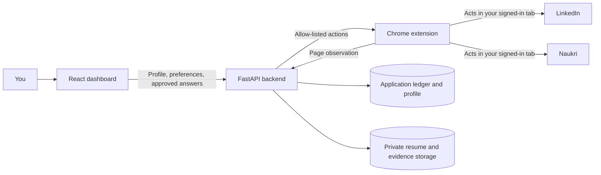

# AutoApply

**A profile-aware job-application assistant for LinkedIn and Naukri.**

AutoApply is a browser extension, dashboard, and backend that helps turn a job
search into a more organized and less repetitive process. It uses information you
provide—your resume, profile, preferences, and approved answers—to find relevant
roles and complete supported in-platform application steps in your own browser.

> **Important:** Automating job-platform interactions can violate platform terms
> and may lead to warnings, verification challenges, temporary limits, or account
> restrictions. AutoApply cannot guarantee that an account will not be restricted.
> Read [Platform risk and responsible use](#platform-risk-and-responsible-use)
> before enabling a live run.

## What problem does it solve?

Applying to jobs repeatedly means re-entering the same profile details, answering
the same screening questions, and keeping track of many job links and outcomes.
AutoApply aims to reduce that repetition while keeping the job seeker in control
of their data and of answers that need judgment.

It is designed to:

- Keep a reusable profile and resume, rather than asking you to start from scratch
  for every supported application.
- Match jobs against the roles and preferences you enter.
- Reuse grounded profile facts and answers you have approved.
- Complete supported **Easy Apply** flows in LinkedIn and supported application
  flows in Naukri.
- Save applications that leave the platform to **Preferred jobs** so you can
  continue on the company's website yourself.
- Show outcomes and jobs needing your input in a dashboard ledger.

AutoApply is not a job board, a guarantee of employment, or an unrestricted
cross-site bot. The extension supports specific platform page structures; a site
redesign or an unsupported form may require manual work.

## How it works

The central design boundary is simple: **the extension owns the browser page; the
backend owns the application decisions.**



### 1. You teach it about your background

During setup, you can upload a PDF or DOCX resume. The backend extracts available
text and uses it to prepare a draft profile. Review and correct the draft before
relying on it. You can also enter information manually.

The profile can include details such as your name, contact information, experience,
skills, education, location, notice period, and compensation expectations. You
also set target job titles, preferred locations and work modes, active hours, and
companies or keywords to avoid.

AutoApply does **not** learn your identity by silently reading unrelated browsing
activity. It uses the profile and preferences you submit, plus the answers you
choose to save and approve.

### 2. It builds a safe answer from known information

When an application asks a screening question, the answer flow is:

1. Match the question to a known profile fact.
2. Look for an answer in your saved question-and-answer bank.
3. If enabled and available, ask a configured language model for a grounded
   proposal based on selected profile facts.
4. Pause and ask you when an answer is sensitive, unknown, or not sufficiently
   supported.

The backend currently supports optional Groq and NVIDIA NIM/Nemotron providers.
Provider credentials stay on the backend; they must never be added to the
dashboard or extension build.

New AI-proposed answers are not treated as approved saved answers automatically.
Review them in the dashboard before they can be reused. The system avoids guessing
on sensitive topics such as demographic details, health, legal eligibility, or
salary negotiations.

When an LLM provider is enabled, relevant question text and profile facts may be
sent to that provider to produce a proposal. Review the provider's privacy terms
and your deployment configuration before enabling this feature. With
`LLM_ENABLED=false`, the backend uses its deterministic rules and saved answers;
it does not make model calls.

### 3. The extension observes and acts in your browser

The extension reads the current supported page and sends a compact observation
to the backend: page type, job details, visible field labels, and temporary
element references. The backend returns a limited set of actions such as filling
a field, choosing an option, clicking a supported control, or submitting an
application. The extension can only act on the references from that observation;
the model does not provide CSS selectors or arbitrary URLs.

The extension operates in a Chrome window where you are already signed in. Your
password is not collected by AutoApply. Easy Apply remains on the platform;
off-platform applications are recorded in Preferred with the company URL when
available, or the LinkedIn job link as a fallback. AutoApply does not follow the
external link and submit the company-site application for you.

### 4. The dashboard tracks the outcome

The application ledger is organized into:

| Dashboard section | What appears there |
|---|---|
| **Applications sent** | Applications recorded as submitted, plus practice-run entries |
| **Waiting for confirmations** | Applications paused because a question needs your review |
| **Preferred jobs** | Relevant jobs whose application continues on an external company site |
| **Can't send** | Other skipped, blocked, or unsupported cases |

The dashboard polls the backend for updated application and run data. It also
provides profile and answer editing, extension pairing, and account data controls.

## Platform risk and responsible use

LinkedIn and Naukri control their own websites and may restrict accounts for
automated activity. A restriction could be triggered even when actions are slow or
look ordinary; platform systems and policies can change without notice. Possible
outcomes include extra verification, CAPTCHA challenges, temporary limits, or
account suspension. **AutoApply does not bypass, defeat, or promise protection
from platform controls.**

The project includes safeguards intended to reduce accidental or excessive
activity—not to evade detection:

- Configurable active hours, quotas, and run limits enforced by the backend.
- A default per-action delay, pauses between applications, and longer breaks.
- A practice-run mode that fills supported forms but does not submit them.
- Stop or human-attention paths for CAPTCHA, security checkpoints, rate limits,
  warning banners, sign-out, unknown pages, sensitive questions, and uncertain
  answers.
- One active run per account and a bounded run window.
- An explicit onboarding risk acknowledgement.

The current plan limits and deployment settings may be lower than hard ceilings.
The code's plan ceilings are at most 25 counted applications per quota day and
6 per hour; the Regular plan is lower (10 per day and 3 per hour). These are
product safety limits, **not platform-approved rates or assurances of safety**.
Check the current safety status in the dashboard and stop immediately if a
platform displays a warning or asks for verification.

Use the extension only with accounts and data you are authorized to use. Check
the current terms and applicable laws for each platform and region. Do not use
AutoApply to misrepresent qualifications, submit answers you have not reviewed,
or automate around a platform warning.

## Supported behavior and current boundaries

- **Platforms:** LinkedIn and Naukri.
- **Easy Apply:** Supported flows can be filled and submitted when the live run
  is enabled and no safety or human-review condition blocks the application.
- **External company applications:** Saved to Preferred for you to open and
  complete manually.
- **Practice run:** Fills forms but never submits; enabled by default in the
  extension build configuration.
- **Unsupported or changed pages:** The run may stop and request attention rather
  than guessing.
- **LLM providers:** Optional; provider keys and models are configured on the
  backend. Rules-only mode is available.
- **Storage:** Development can use local SQLite and local file storage.
  Production supports Postgres and private object storage.

## Try it locally

### Requirements

- Windows, macOS, or Linux
- Python 3.11+
- Node.js and npm
- Google Chrome
- Optional: Google OAuth client and an LLM provider key (not required for a
  local rules-only development run)

The commands below use Windows PowerShell. On macOS or Linux, use
`python3 -m venv .venv`, activate with `source .venv/bin/activate`, and replace
`Copy-Item source destination` with `cp source destination`. The npm and Chrome
steps are otherwise the same.

### 1. Configure and start the backend

From the repository root:

```powershell
cd backend
py -3.11 -m venv .venv
.\.venv\Scripts\Activate.ps1
python -m pip install -e ".[dev]"
Copy-Item .env.example .env
```

Edit `backend/.env` for local development:

- Set `APP_ENV=development`.
- Set `AUTH_DEV_BYPASS=true` to enable the local development sign-in.
- Set a unique `SECRET_KEY` (for example, generate one with
  `python -c "import secrets; print(secrets.token_urlsafe(48))"`).
- Leave `DATABASE_URL` blank to use the local SQLite development database.
- Set `LLM_ENABLED=false` if you want rules-only behavior and no model calls.

Start the API:

```powershell
uvicorn app.main:app --reload --port 8000
```

Check that `http://127.0.0.1:8000/health` responds. In development, the API docs
are available at `http://127.0.0.1:8000/docs`.

### 2. Start the dashboard

Open a second terminal at the repository root:

```powershell
cd dashboard
npm install
Copy-Item .env.example .env
```

In `dashboard/.env`, set `VITE_ENABLE_DEV_LOGIN=true` for local development.
The dashboard uses the same-origin `/api` path and Vite proxies it to the local
backend; leave `VITE_API_BASE_URL` empty.

Start the dashboard:

```powershell
npm run dev
```

Open `http://localhost:5173`, use the development sign-in, and complete onboarding.
Upload and review your resume/profile, set target roles and preferences, and
acknowledge the platform-risk notice.

### 3. Build and load the Chrome extension

Open a third terminal at the repository root:

```powershell
cd extension
npm install
Copy-Item .env.example .env
```

For local development, confirm `extension/.env` contains:

```dotenv
WXT_API_BASE_URL=http://localhost:8000/api
WXT_DASHBOARD_URL=http://localhost:5173
WXT_DRY_RUN_DEFAULT=true
```

Build the unpacked extension:

```powershell
npm run build
```

Then in Chrome:

1. Visit `chrome://extensions`.
2. Turn on **Developer mode**.
3. Select **Load unpacked**.
4. Choose `extension/.output/chrome-mv3`.
5. In the dashboard, open **Settings → Connect extension** and generate a
   pairing code.
6. Open the AutoApply extension popup and enter that code.
7. Sign in to LinkedIn or Naukri in Chrome, then start with a **Practice run**.

Keep the extension's run window open and do not minimize it during a run. Inspect
the page or open the dashboard to confirm the observed job, the action log, and
the ledger entry. A practice run never submits an application. Only turn practice
mode off after you have checked your profile, resume, saved answers, and behavior.

### Production configuration

For a real deployment, configure Google sign-in, a production database, private
object storage, a strong backend secret, the dashboard/API origins, and any
optional model providers. Build the dashboard and extension with their production
API/dashboard URLs; the extension's `WXT_*` values are included in its build and
are public, so **never put secrets in extension or dashboard environment
variables**. Keep backend storage keys and model keys exclusively on the server.

The backend's [setup guide](backend/README.md) covers database migrations,
Google OAuth, storage, environment settings, and deployment checks.

## Development and tests

Run commands in each component directory.

```powershell
# Backend
cd backend
.\.venv\Scripts\python.exe -m pytest -q

# Dashboard
cd ..\dashboard
npm run build

# Extension
cd ..\extension
npm test
npm run compile
npm run build
```

More backend details and test scenarios are in
[backend/README.md](backend/README.md) and [backend/TESTING.md](backend/TESTING.md).
The system boundary and extension/backend contract are documented in
[ARCHITECTURE.md](ARCHITECTURE.md).

## Repository map

```text
backend/                 FastAPI API, LangGraph agent, policy, persistence, tests
dashboard/               React dashboard, onboarding, profile, preferences, ledger
extension/               WXT / Chrome MV3 extension and platform DOM adapters
packages/shared/          JSON Schema contract shared by backend and extension
ARCHITECTURE.md            Detailed architecture and request/response flow
```

## Security and privacy notes

- Dashboard sessions and extension tokens have separate scopes. Pairing codes
  are short-lived and single-use; extension credentials can be revoked in
  Settings.
- The extension submits page observations and executes actions in your signed-in
  browser; it does not receive your platform password.
- Resumes and screenshots belong in private storage. Production storage should
  use the configured private bucket and short-lived signed URLs.
- Model-provider calls are optional. If enabled, relevant question and profile
  context is sent to the configured provider.
- Use local `.env` files for secrets. Do not commit credentials, resume files,
  database files, pairing codes, or extension tokens.
- The application has a delete-account flow; review its behavior and your storage
  configuration before deploying for other people.

## License

No license file is currently included. Until the project owner adds one, do not
assume that this repository grants permission to redistribute or use the code
commercially.
