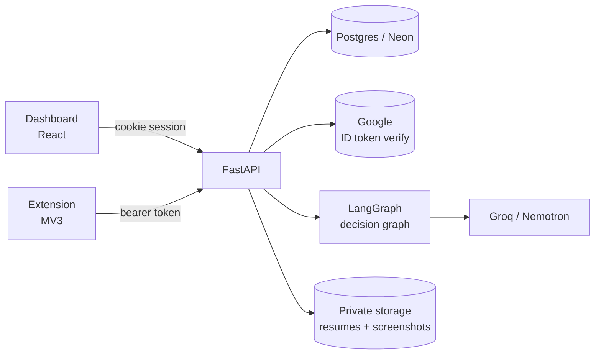

# AutoApply Agent — Backend

FastAPI + Postgres + LangGraph. This service makes **decisions**; the browser
extension owns the page and performs the actions. See `../V1-BUILD-PLAN.md` for the
full design and `../project-plan (1).md` for the product spec.

- **How it works end to end, every endpoint, and the extension contract:**
  [`../ARCHITECTURE.md`](../ARCHITECTURE.md)
- **A click-by-click Swagger walkthrough of the whole flow:** [`TESTING.md`](TESTING.md)
- Setup, tests and deployment: this file.



---

## What it does

| Area | Endpoints | Notes |
|---|---|---|
| Auth | `/auth/google`, `/auth/dev-login`, `/auth/logout`, `/auth/me` | Google-only. No passwords anywhere in the schema. |
| Resume | `POST /resume`, `GET /resume/draft`, `POST /resume/manual` | PDF/DOCX text extraction, then heuristic + LLM parsing with per-field confidence. |
| Profile | `GET/PUT /profile`, `GET/PUT /preferences`, `POST /onboarding/complete` | Onboarding gate requires roles, platforms and accepted risk notice. |
| Answers | `GET/POST /qa`, `PATCH/DELETE /qa/{id}` | Editable in v1. AI answers start unapproved. |
| Extension | `POST /extension/pair`, `POST /extension/connect`, `GET/DELETE /extension/tokens`, `POST /platform/status`, `GET /extension/resume-file` | 8-char single-use pairing code, then a hashed bearer token. |
| Runs | `POST /runs/start`, `POST /runs/{id}/heartbeat`, `POST /runs/{id}/stop`, `GET /runs/active` | Policy-checked start, heartbeat re-check, one run per user. |
| Agent | `POST /agent/step` | Observation in, allow-listed actions out. |
| Ledger | `GET /applications`, `PATCH /applications/{id}`, `POST /applications/{id}/screenshot`, `GET /applications/{id}/screenshot-url` | Every touched job, with reason and optional evidence. |
| Safety | `GET /safety/status` | Caps, cooldown, active hours, usage. |
| Account | `DELETE /account` | Removes rows and storage objects. |
| Ops | `GET /health`, `POST /internal/sweep` | Liveness and the cron-driven maintenance job. |

Interactive docs at `/docs` (development only; disabled in production).

---

## Quick start

```bash
cd backend
python -m venv .venv
# Windows
.venv\Scripts\activate
# macOS / Linux
source .venv/bin/activate

pip install -e ".[dev]"
cp .env.example .env        # then edit at least SECRET_KEY
```

Generate a secret:

```bash
python -c "import secrets; print(secrets.token_urlsafe(48))"
```

With `APP_ENV=development` and no `DATABASE_URL`, the app falls back to SQLite in
`./.data/dev.db` and creates the tables on startup, so you can run it before Neon
exists:

```bash
uvicorn app.main:app --reload --port 8000
```

Check it:

```bash
curl http://localhost:8000/health
```

### With Postgres (the real path)

```bash
export DATABASE_URL="postgresql+asyncpg://...-pooler.../autoapply?ssl=require"
export DATABASE_URL_UNPOOLED="postgresql+asyncpg://.../autoapply?ssl=require"
alembic upgrade head
```

Migrations use the **unpooled** URL: Neon's pooler in transaction mode cannot hold
the locks Alembic takes. Production never creates tables at startup — it refuses to,
so schema drift shows up in review instead of at runtime.

### Signing in locally without Google

Set `AUTH_DEV_BYPASS=true` and `APP_ENV=development`, then:

```bash
curl -c jar.txt -X POST http://localhost:8000/api/auth/dev-login \
  -H "Content-Type: application/json" -d '{"email":"you@example.com"}'
```

This route returns 404 in production and whenever the flag is off. For real Google
sign-in, set `GOOGLE_CLIENT_ID` and have the dashboard send the ID token to
`POST /api/auth/google`.

---

## Google setup (once)

1. Google Cloud Console → **APIs & Services → Credentials**.
2. Create an **OAuth client ID** of type *Web application*.
3. Add **Authorised JavaScript origins**: `http://localhost:5173` and your
   production dashboard origin.
4. Copy the client ID into `GOOGLE_CLIENT_ID` (backend) and
   `VITE_GOOGLE_CLIENT_ID` (dashboard). No client secret and no redirect URI are
   needed: the flow is a verified ID token, not an authorization-code exchange.

---

## Object storage (Supabase)

Resumes and stuck-step screenshots never go in the database. They go into a
**private** bucket and are read only through short-lived signed URLs.

Cloudflare R2 was the original choice but it requires a credit card, so v1 uses
**Supabase Storage**. There are two ways to reach it, and they use **different
credentials**:

| `STORAGE_BACKEND` | Credentials | Notes |
|---|---|---|
| `supabase` **(default in production)** | `SUPABASE_URL` + `SUPABASE_SECRET_KEY` (`sb_secret_...`) | Storage REST API. The project keys you already have are enough. |
| `s3` | `S3_ACCESS_KEY_ID` + `S3_SECRET_ACCESS_KEY` | S3 protocol. Requires a separate key pair from Storage → S3 access keys. An `sb_secret_` key will **not** work here. |
| `local` | none | Files on disk. Development default. |

Setup for the REST path (no extra keys, no credit card):

```bash
STORAGE_BACKEND=supabase
SUPABASE_URL=https://<project-ref>.supabase.co
SUPABASE_SECRET_KEY=sb_secret_...
SUPABASE_BUCKET=autoapply-private
SUPABASE_AUTO_CREATE_BUCKET=true
```

The bucket is created **private** on first upload if it does not exist. Verify:

```bash
python scripts/storage_check.py
```

It uploads a small object, reads it back, signs a URL, **fetches that URL over
HTTPS**, deletes the object, and prints a hint for each common failure (bad key,
missing bucket, wrong region). Non-zero exit on failure, so it works in a deploy
pipeline.

Safety notes that matter:

- `SUPABASE_SECRET_KEY` bypasses row-level security. **Backend only** — never in the
  dashboard, the extension, or a public build. The publishable key is the browser-safe
  one and v1 does not use it.
- The bucket is verified private: unsigned reads return 400/401, and only signed URLs
  (default 300 s) return bytes. `scripts/storage_check.py` checks this on every run.
- The publishable key and `SUPABASE_JWKS_URL` are for Supabase **Auth**. v1 signs
  users in with Google and verifies the ID token itself, so neither is needed.

**What is tested:** `tests/test_storage_supabase.py` runs a fake Storage API server
over real HTTP and covers upload, read, sign, fetching the signed URL, auto-creating
the bucket, wrong-key errors, the app-level resume flow and bucket purge on account
deletion. `tests/test_storage_s3.py` does the same for the S3 protocol against a real
S3 server (moto). Neither can prove Supabase's server agrees with us — that is what
`scripts/storage_check.py` is for, and it passes against the live project.

---

## Configuration

Every setting is documented in `.env.example`, and a test asserts the file matches
`app/core/config.py` exactly (60 settings). The important ones:

| Variable | Required | Why |
|---|---|---|
| `SECRET_KEY` | yes | Signs pairing-code hashes and file URLs. Production rejects anything short or default. |
| `DATABASE_URL` | production | Neon pooled URL. |
| `DATABASE_URL_UNPOOLED` | for migrations | Alembic only. |
| `GOOGLE_CLIENT_ID` | production | Verifies ID tokens. |
| `AUTH_DEV_BYPASS` | dev only | Local sign-in. Production refuses to boot with it on. |
| `GROQ_API_KEY`, `NVIDIA_API_KEY` | no | Without them the app runs rules-only; everything except free-text parsing still works. |
| `LLM_ENABLED` | no | Master switch. `false` guarantees zero model calls. |
| `STORAGE_BACKEND` | no | `local` in dev, `supabase` in production (REST API with the project keys). `s3` is supported but needs a separate S3 key pair. |
| `CRON_SECRET` | production | Protects `POST /internal/sweep`. |

Safety defaults are configurable but **hard-ceilinged in code**: configuration can
lower the daily/hourly caps, never raise them past 25 and 6.

**The daily quota is 10 applications per quota day, and the day resets at 10:00 in the
user's own timezone** (`SAFETY_DAY_RESET_HOUR=10`, `SAFETY_DEFAULT_TIMEZONE`). It is
enforced in three places — at run start, on every heartbeat, and at the moment of
submission inside `/agent/step`, where the `submit` action is removed from the response
if the allowance is gone. Historical `dry_run` application records still count.
New runs are live and reject practice mode. See
[`../ARCHITECTURE.md`](../ARCHITECTURE.md#551-the-daily-quota-in-detail).

---

## Testing

```bash
pytest -q                 # 200 tests
pytest tests/test_safety.py -q
ruff check app tests evals
```

The suite runs against in-memory SQLite. Production is Postgres, but no query uses a
Postgres-only operator: `app/db/types.py` degrades `JSONB`/`ARRAY` to `JSON` on
SQLite, and every ORM path under test is the one that runs in production.

| File | Covers |
|---|---|
| `test_smoke.py` | Boot, health, dev sign-in, CSRF gate, onboarding gate |
| `test_authz.py` | Cross-user isolation, extension scope limits, revocation, expiry, account deletion |
| `test_safety.py` | Caps, warm-up, cooldown, rest day, active hours, run window, one-run-per-user, heartbeat sweep, pacing floors |
| `test_agent_step.py` | Every graph branch, legacy dry-run guard, unknown refs rejected, duplicate applications |
| `test_answers.py` | Rules → bank → model order, sensitive routing, invented numbers rejected |
| `test_resume.py` | DOCX parse, scanned-PDF fallback, size/type rejection |
| `test_quota.py` | The 10/day quota, the 10:00 local reset, timezone handling, warm-up ramp, and the server-side block on submit |
| `test_contract.py` | JSON Schema and Pydantic agree on valid **and** invalid payloads |
| `test_storage_supabase.py` | Fake Storage API over HTTP: upload, read, sign, signed-URL fetch, bucket auto-create, wrong key, purge on account deletion |
| `test_storage_s3.py` | Real S3 server: the same list through the S3 protocol |
| `test_config.py` | `.env.example` parity and every production startup guard |
| `test_flow.py` | The whole user journey, screenshots, ledger filters, cron secret |
| `test_evals.py` | The eval suites below |

### Evals

```bash
python -m evals.run            # all suites
python -m evals.run sensitive  # one
python -m evals.run --json     # for CI
```

Deterministic and free: no provider is called. Current state — **74/74 cases**:

| Suite | Metric | Threshold |
|---|---|---|
| `sensitive_routing` | sensitive recall 1.00, standard specificity 1.00 | ≥0.95 / ≥0.90 |
| `injection_detection` | hostile recall 1.00, clean specificity 1.00 | ≥0.90 / ≥0.90 |
| `answer_groundedness` | grounded 1.00, 19/19 answered from the profile with zero model calls | 1.00 |
| `resume_parsing` | field accuracy 1.00 across 5 synthetic resumes | ≥0.95 |

To compare Groq against Nemotron on the same datasets, set `LLM_ENABLED=true` and a
key, then re-run. Model names live in config, never in code.

---

## Design notes worth knowing

**Auth is opaque sessions, not JWT.** The cookie holds 32 random bytes; the database
holds a SHA-256 digest. That buys instant revocation and removes refresh-token
machinery entirely. The dashboard never stores a token in `localStorage`.

**Dashboard and API are same-origin** through an `/api` proxy. That is what makes
`SameSite=Lax` sufficient and keeps cookies first-party. Unsafe methods additionally
require `X-Requested-With: XMLHttpRequest`, which a cross-site form cannot set.

**The LLM never sees a selector or a URL.** It receives an observation of `ref`
handles and returns an allow-listed action batch. `validate_actions` rejects any ref
that was not in the current observation. This is the prompt-injection boundary.

**The graph has no checkpointer.** `/agent/step` is an HTTP step function, so
resumable state lives in `agent_runs.agent_state` on the server. That survives a
reloaded tab, a restarted worker and a different instance — the MV3 problem the plan
calls out.

**Answers resolve rules → bank → model → human.** Profile rules are free and instant.
Anything sensitive (demographics, disability, caste/religion, legal declarations,
criminal history, salary negotiation) never reaches a model at all.

**One run per user is enforced by the database**, via a partial unique index on
`agent_runs` where `status = 'running'`, not just by an application check.

---

## Deployment

| Piece | Where | Note |
|---|---|---|
| API | Render / Railway / Fly | Single instance; the maintenance loop runs in-process. |
| DB | Neon | Pooled for the app, unpooled for migrations. |
| Files | Supabase Storage | Private bucket, signed URLs only. REST API by default; S3 optional. |
| Scheduler | Any cron | `POST /internal/sweep` with `X-Cron-Secret`. Disable the in-process loop if you scale past one instance. |

Production startup requires: `SECRET_KEY` (32+ unique chars), `GOOGLE_CLIENT_ID`,
`CRON_SECRET`, `AUTH_DEV_BYPASS=false`, and complete Supabase storage settings if
`STORAGE_BACKEND=supabase`. It refuses to boot otherwise — that check is in
`Settings.validate_for_runtime`.

---

## Known limitations in v1

These are stated, not hidden:

- **Google is the only sign-in.** No email/password, no password reset. A user who
  loses access to their Google account loses access here.
- **No email verification flow** of our own; we trust Google's `email_verified` claim.
- **Text-based resumes only.** A scanned PDF gets a friendly message and a manual
  entry path; OCR is v1.1.
- **The rate limiter is in-process.** It is correct for one instance. Scaling
  horizontally requires Redis or an edge limiter, or each instance keeps its own
  counters.
- **Safety defaults are conservative guesses**, not measured platform limits. They
  are tuned for account survival, not throughput.
- **Automating LinkedIn and Naukri may violate their terms of service** and can get an
  account restricted. The defaults are deliberately slow, and the app stops at the
  first sign of friction — but that risk is real and belongs to the user. The
  onboarding step requires explicit acceptance, and Settings can delete all data.
- **No per-job resumes or cover letters**, no external-company-site applying, no
  analytics. All v2.
- **`langgraph-checkpoint-postgres` is not used**; see the design note above.
