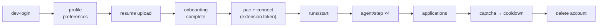

# Testing the Backend — a Swagger walkthrough

Follow this once and you will have exercised every part of the system: auth,
resume parsing, storage, onboarding, the extension handshake, the agent's decisions,
the ledger, the safety caps and the cooldown.

Everything below is copy-paste. No Google account is needed.



---

## 1. One-time setup

`backend/.env` needs these two lines. `AUTH_DEV_BYPASS` is what replaces Google:

```bash
APP_ENV=development
AUTH_DEV_BYPASS=true
```

Start the server:

```bash
cd backend
.venv\Scripts\activate        # Windows
uvicorn app.main:app --reload --port 8000
```

Open **<http://localhost:8000/docs>**.

Swagger UI only exists outside production — on a deployed server it is switched off
on purpose, which is why you test this locally.

---

## 2. The three things that trip everyone up

Read these before clicking anything.

**1. Every write needs a CSRF header.** `POST`, `PUT`, `PATCH`, `DELETE` on dashboard
routes require:

```
x-requested-with: XMLHttpRequest
```

Swagger now shows it as a field on those routes (labelled `x-requested-with`). If you
leave it blank you get:

```json
{ "error": { "code": "forbidden", "message": "Missing request header." } }
```

It is *optional* on `GET`, so you can ignore it there.

**2. Extension routes need a bearer token.** They are marked with a padlock. Click
**Authorize** (top-right, padlock icon), paste the raw token that starts with
`aa_ext_` — no `Bearer` prefix — and Authorize. It then applies to all extension
routes.

**3. You are already signed in after step 2.** Swagger runs in the same browser
against the same origin, so the `aa_session` cookie is stored automatically. You do
not have to paste cookies anywhere.

---

## 3. The full flow

Do these in order. Each step lists what to send and what you should see.

### Step 1 — Is it alive?

`GET /health` → **Try it out** → **Execute**

```json
{
  "status": "ok",
  "database": "ok",
  "version": "0.1.0",
  "env": "development",
  "llm": { "enabled": false, "resume_parse": [], "classify": [], "answer": [], "max_calls_per_run": 30 }
}
```

`database: "ok"` means the Postgres/SQLite connection works. If `status` is
`degraded`, the database is unreachable — check `DATABASE_URL`.

---

### Step 2 — Sign in without Google

`POST /api/auth/dev-login` → **Try it out**

```json
{ "email": "you@example.com" }
```

Expect `200` and a `MeOut` body:

```json
{
  "user": { "id": "…", "email": "you@example.com", "name": "You", … },
  "onboarding": { "step": 1, "done": false, "has_resume": false, "parse_status": "none", "needs_risk_consent": true },
  "platforms": [ { "platform": "linkedin", "signed_in": false }, { "platform": "naukri", "signed_in": false } ],
  "preferences_ready": false,
  "llm": { "enabled": false, … }
}
```

`onboarding.done: false` is correct — that is the gate you are about to satisfy.

> `404` here means `APP_ENV` is not `development` or `AUTH_DEV_BYPASS` is not `true`.

`GET /api/auth/me` should now return the same body. That proves the cookie works.

---

### Step 3 — Fill in the profile

`PUT /api/profile` → **Try it out** → set `x-requested-with` to `XMLHttpRequest`

```json
{
  "full_name": "Priya Sharma",
  "phone": "+91 98765 43210",
  "location": "Pune, India",
  "current_title": "Backend Engineer",
  "current_company": "Acme Systems",
  "years_of_experience": 5,
  "notice_period_days": 60,
  "current_ctc_lpa": 18,
  "expected_ctc_lpa": 24,
  "skills": ["Python", "FastAPI", "PostgreSQL"]
}
```

Expect `200` with the same values back. This is the data the agent answers forms
from, so realistic values make step 9 more interesting.

---

### Step 4 — What the user wants

`PUT /api/preferences`

```json
{
  "target_roles": ["Backend Engineer", "Python Developer"],
  "platforms": ["linkedin", "naukri"],
  "locations": ["Pune", "Remote"],
  "work_mode": ["remote", "hybrid"],
  "active_hours": { "start": "00:00", "end": "23:59", "timezone": "Asia/Kolkata" },
  "daily_cap": 10
}
```

> The wide `active_hours` is deliberate: the default window is 09:00–21:00 local, and
> outside it `/runs/start` refuses with `outside_active_hours`.

---

### Step 5 — Finish onboarding

`POST /api/onboarding/complete`

```json
{ "risk_accepted": true }
```

Expect `200` and `onboarding.done: true`. Sending `false` returns `422` — the risk
notice is a real gate, not a checkbox that gets ignored.

---

### Step 6 — Upload a resume

`POST /api/resume` → **Try it out** → **Choose File** → pick any text-based PDF or
DOCX → Execute.

Expect `200`:

```json
{
  "parse_status": "parsed",
  "draft": { "full_name": "Priya Sharma", "confidence": { "email": "high" } },
  "confidence": { "full_name": "high", "email": "high", "years_of_experience": "medium", … },
  "profile": { "full_name": "Priya Sharma", "has_resume": true, "onboarding_step": 2, … }
}
```

Two things worth trying:

- A **scanned** PDF returns `200` with `parse_status: "failed"` and a friendly
  `message`, not an error — the UI is meant to offer manual entry.
- A `.txt` file returns `415`, and anything over 5 MB returns `413`.

---

### Step 7 — Look at the file you stored

`GET /api/resume/file-url` → copy the `url` into a new browser tab.

That is a **signed URL valid for 300 seconds**. It works without logging in, which is
the whole point of a private bucket. Paste a character out of it and you get `403`.

---

### Step 8 — See the quota

`GET /api/safety/status`

```json
{
  "allowed": true,
  "message": "Ready.",
  "usage": {
    "applied_today": 0,
    "effective_daily_cap": 5,
    "warmup_cap": 5,
    "effective_hourly_cap": 3,
    "day_reset_hour": 10,
    "active_timezone": "Asia/Kolkata",
    "quota_resets_at": "2026-10-27T04:30:00+00:00"
  },
  "daily_ceilings": { "configured_daily": 10, "hard_daily": 25, "configured_hourly": 3, "hard_hourly": 6 }
}
```

`effective_daily_cap` is **5 on day one** and ramps to 10 over 14 days (new-account
warm-up). `quota_resets_at` is 10:00 IST the next morning.

---

### Step 9 — Pair the extension (and get your bearer token)

**9a.** `POST /api/extension/pair` (needs the CSRF header, it is a dashboard route).

```json
{ "code": "FT4H4HYR", "expires_at": "…", "instructions": "Open the extension, paste this code…" }
```

**9b.** `POST /api/extension/connect` — this one is public, the code *is* the credential.

```json
{ "code": "FT4H4HYR", "install_id": "swagger", "label": "Swagger test" }
```

```json
{ "token": "aa_ext_xxxxxxxx…", "user_email": "you@example.com", "user_name": "You" }
```

**9c.** Copy that token. Click **Authorize** (padlock, top right), paste it **without**
the word `Bearer`, Authorize.

**9d.** The code is single-use. Re-running 9b with the same code returns `401` — that
is the behaviour you want, and it is worth checking.

---

### Step 10 — Tell the backend the platform is signed in

`POST /api/platform/status` (now authenticated by the token)

```json
{ "platform": "linkedin", "signed_in": true }
```

Expect `204`. Then `GET /api/auth/me` → the `linkedin` chip is now `signed_in: true`.
That is what the dashboard shows as **Connected**.

---

### Step 11 — Start a dry run

`POST /api/runs/start`

```json
{ "platform": "linkedin", "dry_run": true }
```

```json
{
  "run": {
    "id": "0e6c…", "platform": "linkedin", "status": "running", "dry_run": true,
    "max_applications": 5, "applied_count": 0, "skipped_count": 0, "stuck_count": 0, "llm_calls": 0
  },
  "pacing": { "action_delay_ms": 806, "apply_pause_s": 80, "long_break_s": null },
  "heartbeat_seconds": 20,
  "keep_tab_visible": true,
  "usage": { "effective_daily_cap": 5, … }
}
```

**Copy the run `id`** — every remaining step uses it.

If you get `403 policy_blocked`, the message says exactly why (rest day, outside
active hours, cooldown, cap). For local testing on a Sunday, start the server with
`SAFETY_REST_DAY=7`.

---

### Step 12 — Ask the agent what to do on a job page

`POST /api/agent/step`

```json
{
  "run_id": "<paste the run id>",
  "platform": "linkedin",
  "page_type": "job_detail",
  "job": {
    "id": "swagger-1",
    "title": "Backend Engineer",
    "company": "Acme Systems",
    "location": "Pune, IN",
    "job_url": "https://www.linkedin.com/jobs/view/swagger-1",
    "already_applied": false,
    "external": false
  },
  "elements": [
    { "ref": "b1", "kind": "button", "label": "Share" },
    { "ref": "b2", "kind": "button", "label": "Easy Apply" }
  ],
  "signals": []
}
```

Expect:

```json
{
  "actions": [ { "type": "click", "ref": "b2" } ],
  "status": "continue",
  "meta": { "applied_count": 0, "llm_calls": 0, "llm_calls_left": 30, "pacing": { … } }
}
```

It picked `b2` because the label says *Easy Apply* and skipped *Share*. This is the
whole "backend decides, extension acts" contract in one response.

> The observation is what the extension sends. `ref` values are arbitrary handles for
> that page only — `^[a-z][0-9]{1,4}$`. The backend never sees a selector.

---

### Step 13 — Fill the application form

`POST /api/agent/step`

```json
{
  "run_id": "<run id>",
  "platform": "linkedin",
  "page_type": "apply_form",
  "job": { "id": "swagger-1", "title": "Backend Engineer", "company": "Acme Systems" },
  "elements": [
    { "ref": "f1", "kind": "text", "label": "Full name", "required": true },
    { "ref": "f2", "kind": "text", "label": "Mobile number", "required": true },
    { "ref": "f3", "kind": "text", "label": "Current CTC", "required": true },
    { "ref": "f4", "kind": "text", "label": "Notice period", "required": true },
    { "ref": "b9", "kind": "button", "label": "Submit application" }
  ],
  "signals": []
}
```

Expect:

```json
{
  "actions": [
    { "type": "fill_text", "ref": "f1", "value": "Priya Sharma" },
    { "type": "fill_text", "ref": "f2", "value": "+91 98765 43210" },
    { "type": "fill_text", "ref": "f3", "value": "18 LPA" },
    { "type": "fill_text", "ref": "f4", "value": "2 months" }
  ],
  "status": "done",
  "reason": "dry_run_complete",
  "meta": { "job_status": "dry_run", "llm_calls": 0 }
}
```

Three things to notice:

1. Every value came from the profile, with **zero model calls**.
2. There is **no `submit` action** — it is a dry run. The fills are still returned so
   you can watch the form get filled on a real page.
3. `status: "done"` means this job is finished; the extension moves to the next one.

Change `dry_run` to `false` when starting a run (step 11) and the same request returns
a `submit` action plus `job_status: "applied"`.

---

### Step 14 — A question the agent refuses to answer

`POST /api/agent/step` with a different job id:

```json
{
  "run_id": "<run id>",
  "platform": "linkedin",
  "page_type": "chat_question",
  "job": { "id": "swagger-2", "title": "Backend Engineer", "company": "Other Co" },
  "elements": [ { "ref": "b9", "kind": "button", "label": "Next" } ],
  "chat": {
    "question": "Do you have any disability we should know about?",
    "input_ref": "c1"
  },
  "signals": []
}
```

Expect:

```json
{ "actions": [], "status": "hitl", "reason": "sensitive_question", "meta": { "job_status": "needs_attention" } }
```

Empty `actions` is deliberate: the agent does not half-fill a form it cannot finish.

Try these instead to see the difference:

| `chat.question` | Result |
|---|---|
| `What is your expected CTC?` | `fill_text` `c1` = `24 LPA`, `status: continue` |
| `How many years of experience in Python?` | `fill_text` = `5` |
| `Are you willing to relocate?` | `fill_text` = `Yes` or `No` from preferences |
| `Describe a time you disagreed with your manager.` | `hitl` / `unknown_question` |
| `Are you legally authorized to work in the US?` | `hitl` / `sensitive_question` |

---

### Step 15 — Check the ledger

`GET /api/applications`

```json
{
  "items": [
    { "id": "…", "platform": "linkedin", "job_id": "swagger-2", "status": "needs_attention",
      "reason": "sensitive_question", "reason_label": "Needs your own answer", "has_screenshot": false },
    { "id": "…", "platform": "linkedin", "job_id": "swagger-1", "status": "dry_run",
      "reason": "dry_run_complete", "reason_label": "Practice run: filled but not submitted" }
  ],
  "total_unresolved": 1
}
```

Now resolve the stuck one — this is the "Needs you" button:

`PATCH /api/applications/{id}` with the `needs_attention` id:

```json
{ "status": "resolved" }
```

`total_unresolved` drops to `0`.

Filters work too: `GET /api/applications?status=needs_attention&platform=linkedin`.

---

### Step 16 — Heartbeat

`POST /api/runs/{run_id}/heartbeat`

```json
{ "run": { "status": "running", … }, "allowed": true, "message": "Ready.", "reason": null }
```

The extension calls this every 20 s. If it ever returns `allowed: false`, the
extension must stop immediately — the backend has already ended the run.

---

### Step 17 — Make it stop: a CAPTCHA

`POST /api/agent/step` with a third job id and a risk signal:

```json
{
  "run_id": "<run id>",
  "platform": "linkedin",
  "page_type": "job_detail",
  "job": { "id": "swagger-3", "title": "Backend Engineer" },
  "elements": [],
  "signals": ["captcha"]
}
```

```json
{ "actions": [], "status": "stop", "reason": "captcha" }
```

Now check the consequences:

1. `GET /api/runs/active` → `"run": null` (the run was stopped).
2. `GET /api/safety/status` → `allowed: false`, a `cooldown_until` about 48 hours out.
3. `POST /api/runs/start` again → `403`:

```json
{ "error": { "code": "policy_blocked", "message": "Paused for safety until 28 Oct, 21:31. Something on the platform looked like a check." } }
```

That is the account-protection behaviour, start to finish.

Also worth trying the same request with `"signals": ["checkpoint"]` (security check),
`["warning_banner"]`, `["forced_logout"]` or `["rate_limited"]` — each maps to its own
reason and cooldown.

---

### Step 18 — Clean up

`DELETE /api/account` (CSRF header required).

Expect `204`. Then `GET /api/auth/me` → `401`, and the resume object is gone from the
bucket.

Because the cooldown belongs to that user, deleting the account clears it too — you can
run the whole walkthrough again from step 2.

---

## 4. Failure paths worth testing on purpose

| What to do | Expected |
|---|---|
| Any `POST` with a blank `x-requested-with` | `403 forbidden`, "Missing request header." |
| `GET /api/profile` in a private window with only the bearer token | `401 auth_required` (extension scope cannot read the profile) |
| `POST /api/extension/connect` with the same code twice | `401`, code already used |
| `POST /api/runs/start` while a run is active | `409` or `403 policy_blocked` |
| `POST /api/agent/step` with another user's `run_id` | `404` |
| `POST /api/agent/step` with `platform: "naukri"` on a LinkedIn run | `409` |
| `POST /api/agent/step` after the run stopped | `409` |
| `GET /api/resume/draft` before uploading | `404` |
| `GET /api/applications?status=banana` | `422 validation_error` |
| Upload a `.txt` / a 6 MB file | `415` / `413` |
| `DELETE /api/extension/tokens/{id}`, then use the token | `401` |

---

## 5. The same flow, without clicking

```bash
# 33 assertions over the whole journey, ~3 seconds
python scripts/smoke_test.py
python scripts/smoke_test.py --base-url https://your-api.onrender.com
python scripts/smoke_test.py --keep-account     # inspect the result in the dashboard

# storage only: upload, sign, fetch the signed URL, delete
python scripts/storage_check.py

# the real test suite: 210 tests, no server needed
pytest -q
pytest tests/test_flow.py -q                    # just the end-to-end file
pytest tests/test_quota.py -q                   # just the caps and reset
```

The tests do **not** touch the database or the bucket in your `.env` — they run
against in-memory SQLite and a local test server.

---

## 6. Troubleshooting

| Symptom | Cause |
|---|---|
| `401 auth_required` | No session cookie. Run step 2 first, in the same browser. |
| `403 forbidden` "Missing request header." | `x-requested-with: XMLHttpRequest` is missing on a write. |
| `403 policy_blocked` | Safety rules. The message names the rule (cooldown, rest day, hours, cap). |
| `404` on `/api/auth/dev-login` | `APP_ENV` is not `development`, or `AUTH_DEV_BYPASS` is not `true`. |
| `422 validation_error` | The field list is in `error.details`, e.g. `[{"field":"daily_cap","message":"…"}]`. |
| `409 conflict` | A run is already active, or this run is not running. Check `/api/runs/active`. |
| `500 internal_error` | Look at the server console — the traceback is logged with a request id. |
| `/docs` is 404 | Production mode. Swagger is disabled when `APP_ENV=production`. |
| Signed URL gives `403` | It expired (300 s) or the signature was altered. Ask for a new one. |
| Nothing applies / no rows | Check `/api/safety/status` first: a cooldown or a cap explains it. |

---

## 7. What you have proven when you finish

- Sign-in works and the session cookie survives across requests.
- The CSRF gate rejects writes without the header.
- Resume upload parses, prefills the profile and stores the file privately.
- A signed URL serves the resume without credentials, and expires.
- Onboarding cannot complete without roles, platforms and risk acceptance.
- The extension token is scoped: it drives runs but cannot read the profile.
- The agent answers from the profile with zero model calls.
- A dry run never submits; a live run does.
- Sensitive questions go to a human with no actions emitted.
- The ledger records both outcomes and can resolve them.
- A CAPTCHA stops the run and blocks new runs for 48 hours.
- Deleting the account removes the rows and the stored file.